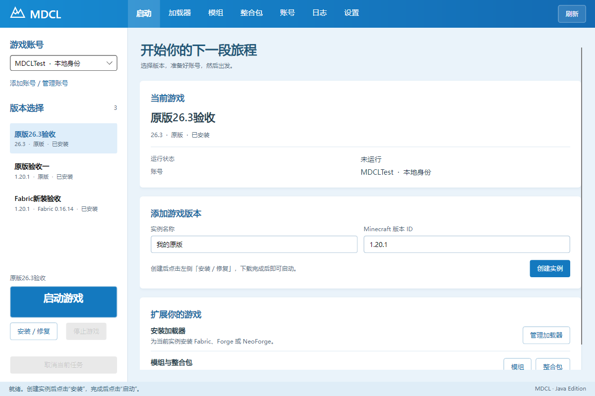

# MountainDogCraftLauncher · MDCL

Minecraft Java 版桌面启动器，采用 C# / .NET 10、Avalonia 和 MVVM，发布 `win-x64`、`osx-arm64`、`osx-x64`。源码采用 MIT 许可证；第三方许可独立保留。



界面采用 PCL 经典蓝白风格：顶部功能导航，左侧账号、实例和启动区，右侧管理页面。布局和图标由 MDCL 实现，未复制 PCL 源码或素材。

## 使用

从本仓库 Releases 下载对应平台包。Windows 解压后运行 `MDCL.Desktop.exe`，无需另装 .NET。先创建实例，填写 Mojang 版本 ID，再点击「安装 / 修复」，完成后启动。Java 按版本要求发现或安装，也可在设置页绑定。

本地身份不提供微软正版会话。微软登录需要为 MDCL 配置专属 public client；不得借用其他启动器的应用 ID。当前开发包未签名；两种 Mac 构建均未真机验证、未签名和未公证。

## 当前证据（2026-10-25）

- 171 项 .NET 自动化测试通过（Core 19、Integration 147、Desktop 5），另有 2 项 Python 发布来源测试通过；锁定还原和 Release 构建通过。
- Windows 原版 `1.20.1`、`26.3` 均在真实下载后两次到达主菜单并正常退出。26.3 使用自动安装的 Temurin Java 25，中文路径已验证。
- Forge 47.2.0、NeoForge 47.1.106 与 Forge + Embeddium mrpack 的既有 Windows 主菜单证据保留；本轮补充取消、恢复、实例隔离与归档验证。
- Fabric 0.16.14 / 0.20.1 可安装，但本机首次 remap 在 Java ZIPFS 写入检查失败，首次启动验收未通过。未将手工预 remap 绕过包装成产品功能。
- 更新器提供清单验签、摘要校验、健康检查、备份、回退与中断恢复。生产根密钥、平台签名与撤销机制尚未验收，桌面自动更新入口未启用。

跨平台构建不代表 Mac 运行通过。真实微软登录、Mac Keychain、Gatekeeper、签名/公证、Mac 游戏启动与性能目标仍未实测。完整边界见[发布矩阵](docs/evidence/release-matrix.md)与[接续验收记录](docs/evidence/continuation-final.md)。

## 构建与测试

需要 .NET SDK **10.0.402**、Python 3.10+。Git checkout 必须已提交且干净；解压源码包可无 Git 构建，文件清单和摘要会校验来源。修改源码后请初始化 Git 并提交，生成新的来源标识。

```powershell
./packaging/test.ps1
python -m unittest discover -s packaging/tests -v
./packaging/package.ps1
```

macOS / Bash：`bash packaging/publish.sh`。也可传入单个 RID。脚本锁定还原、测试并输出自包含产物到 `artifacts/`，不包含游戏文件、账号、令牌或签名私钥。macOS 使用 TAR 保留可执行位；包内附 `.app`、许可证及锁文件。运行 `python packaging/verify-release.py <发布目录>` 可校验三平台包和摘要。

所有用户数据位于系统用户数据目录；`MDCL_DATA_ROOT` 用于隔离测试数据。请勿让旧版和新版同时访问同一数据根：实例租约布局已更新。启动器不自动执行整合包脚本。

## 设计与验收资料

- [具体架构设计](docs/MDCL-具体架构设计.md)、[架构设计](docs/MDCL-架构设计.md)
- [T00—T12 开发任务书](docs/DSH-开发任务书.md)、[验收矩阵](docs/MDCL-验收矩阵.md)
- [视觉规范](DESIGN.md)、[第三方许可证](THIRD-PARTY-NOTICES.md)
- `docs/evidence/T00`—`T12` 为原开发阶段记录；`continuation-*` 为接续开发记录，较新记录优先。未验证的条目不得从代码存在推断通过。
