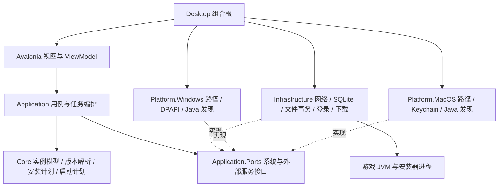

# MDCL 架构设计

版本：1.0；日期：2026-10-24；交付对象：Dsh 开发执行者。

## 产品定位与范围

MDCL 是面向普通玩家的 Minecraft Java 版桌面启动器。借鉴 PCL 的操作引导和故障解释，采用 HMCL 所体现的账号、依赖、安装与启动分工方式，独立建立可测试的跨平台核心。

Windows 与 macOS 是同等产品目标。开发早期就验证两平台，不能先完成 Windows 业务，再把系统调用逐处改成 macOS 分支。

第一阶段交付“选择游戏版本 → 创建隔离实例 → 获取合适 Java → 安装依赖 → 登录 → 启动 → 查看日志 → 退出与再次启动”的真实闭环。后续阶段增加 Fabric、Forge / NeoForge，以及整合包导入和模组管理。

首版不包含基岩版、手机端、Linux、账号交易、云同步、联机隧道和通用插件市场。高级自定义主页、音乐和复杂动效不进入启动链路。它们可以成为后续独立功能。

### 发布基线

| 项目 | 设计要求 |
| --- | --- |
| Windows | Windows 11 24H2 或更新受支持版本，x64；发布 `win-x64` |
| macOS | macOS 15 或更新且仍受支持版本；分别发布 `osx-arm64` 和 `osx-x64` |
| Windows ARM64 | 本期不作为原生发布目标；不能用 x64 模拟运行结果替代原生验收 |
| 旧系统 | Windows 10、macOS 14 及更早版本本期不承诺；需要支持时另立兼容版本计划 |
| 应用运行时 | 自包含 .NET 发布，普通用户不需要预装 .NET SDK |
| 游戏运行时 | 按实例要求单独管理 Java；与 MDCL 自身的 .NET 运行时分开 |
| 权限 | 普通用户运行；不要求管理员权限或关闭系统安全功能 |

系统基线取所选框架与 .NET 支持范围的交集，不只看界面框架能否启动。实现前锁定 Avalonia 稳定版及其原生依赖，禁止使用浮动版本。依据见 [S07](参考依据与决策记录.md#s07-技术栈与系统支持)。

## 技术路线

### 方案比较

| 方案 | 优点 | 代价 | 本设计结论 |
| --- | --- | --- | --- |
| C# / .NET 10 + Avalonia，独立核心 | 一套桌面 UI 与业务核心；便于隔离 Windows / macOS 系统差异；启动器无需 Java 才能运行 | 启动协议与兼容测试需要自己承担 | 采用；符合独立 MDCL 产品及当前双平台要求 |
| Java + JavaFX，基于 HMCL 二次开发 | 可沿用成熟兼容层，更快继承已有功能 | 需维护上游分支并履行 GPL 及附加条款；整体产品结构受上游影响 | 若日后明确优先继承 HMCL 全部功能，再整体改用此路线 |
| Tauri / Electron + 网页 UI | Web 界面开发方便 | 增加前后端通信和桌面桥接；启动核心仍需实现 | 当前需求不需要这层复杂度 |

WPF 只支持 Windows，不适用于本项目的一套共享桌面 UI 要求。

推荐依赖为 Avalonia、CommunityToolkit.Mvvm、Microsoft.Extensions.DependencyInjection / Logging、System.Text.Json 和 Microsoft.Data.Sqlite；采用 xUnit 做核心测试。微软 OAuth 库先做协议适配验证，确认支持所需个人账号与 Xbox scope 后选定，不能因为示例能登录 Microsoft Graph 就认定可登录 Minecraft。

SDK 写入 `global.json`，NuGet 版本写入 `Directory.Packages.props` 并提交锁文件。采用 `net10.0` 共享目标，平台代码单独装配；不默认开启 Native AOT、裁剪或单文件打包。先验证普通自包含目录发布，再逐项优化体积。

### 代码来源边界

本路线参考产品行为、公开协议和模块职责，不直接复制 PCL 代码，也不把 HMCL Java 实现逐段翻译成 C#。源码、图标、文案与代码片段若需要复用，逐项记录来源与许可，再决定是否引入。大量使用上游实现应重新评估整个项目的许可与技术路线。PCL 仓库的使用指南和 HMCL 许可事实见 [S01](参考依据与决策记录.md#s01-pcl-与-hmcl-许可)。

## 总体结构

采用单个桌面进程内的模块化架构。游戏 JVM、安装器和日后的更新程序是受管理的子进程。首版不启动本地 HTTP 服务，也不建立账号后台或数据库服务器。



图中箭头表示调用或装配关系；项目引用只能按下面的方向存在：

```text
Core                    → 无其他 MDCL 项目引用
Application             → Core（其 Ports 只包含接口）
Infrastructure          → Application、Core
Platform.Windows        → Application、Core
Platform.MacOS          → Application、Core
Desktop                 → Application、Core
Desktop/Composition     → Infrastructure、Platform.Windows、Platform.MacOS
Core.Tests              → Core
Integration.Tests       → Application、Infrastructure、平台适配项目
```

桌面工程仅组合根可以引用具体实现。ViewModel 调用用例，不直接发 HTTP、打开 SQLite、启动 Java 或操作 Keychain。Core 不能引用 Avalonia、Windows 注册表或 P/Invoke。按业务能力分文件夹，第一版不为每个能力再拆一个程序集。

### 建议目录

```text
MDCL.sln
global.json
Directory.Build.props
Directory.Packages.props
src/
  MDCL.Core/
    Instances/ Versions/ Installation/ Launch/ Java/ Accounts/ Errors/
  MDCL.Application/
    Ports/ UseCases/ Operations/ Diagnostics/
  MDCL.Infrastructure/
    Metadata/ Network/ Downloads/ Storage/ Authentication/
    Processes/ Installers/ Archives/ Diagnostics/
  MDCL.Platform.Windows/
    Paths/ Credentials/ Java/ Processes/ Shell/
  MDCL.Platform.MacOS/
    Paths/ Credentials/ Java/ Processes/ Shell/
  MDCL.Desktop/
    Composition/ Views/ ViewModels/ Resources/
tests/
  MDCL.Core.Tests/
  MDCL.Integration.Tests/
  MDCL.Desktop.Tests/
  Fixtures/（脱敏元数据、坏文件和小型归档，不放游戏本体）
packaging/
  windows/ macos/
docs/
  decisions/ evidence/
```

## 能力模块与接口边界

| 能力 | 负责内容 | 不应承担的内容 |
| --- | --- | --- |
| InstanceService | 创建、改名、复制、迁移和删除实例；独占租约 | 推测游戏版本、直接下载文件 |
| VersionResolver | 解析官方版本与加载器描述，求出最终依赖和规则 | 修改用户存档、发起登录 |
| InstallPlanner | 根据目标和已有文件生成可验证的步骤计划 | 在生成计划时执行安装器 |
| OperationCoordinator | 执行依赖图；取消、并发和状态事件；恢复入口 | 用 UI 百分比判断任务完成 |
| DownloadService | 多候选源、限流、续传、校验、缓存提交 | 绕过摘要校验来保证成功率 |
| JavaService | 发现、探测、兼容过滤、安装和选择解释 | 按版本字符串大小粗略推断需求 |
| AccountService | OAuth、Xbox / XSTS、Minecraft 会话与身份 | 保存明文凭据、复制别人的 client ID |
| LaunchPlanner | 生成可重复计算的启动计划与预检结论 | 启动进程或持久化访问令牌 |
| GameProcessService | 启动、日志流、退出结果和定向停止 | 扫描并结束所有 java 进程 |
| DiagnosticService | 错误分类、证据截取、脱敏与导出 | 仅凭退出码断言崩溃原因 |

以下是契约草案，不是已实现的 SDK。Dsh 在 T01 固定类型定义；后续若调整，要同步调用方和任务书。

```csharp
// 数据类型均定义在 Core；Ports 接口定义在 Application。
Task<ResolvedVersion> IVersionResolver.ResolveAsync(
    VersionSelection selection, TargetPlatform target, CancellationToken ct);

Task<InstallPlan> IInstallPlanner.CreateAsync(
    InstallRequest request, CancellationToken ct);

Task<OperationResult> IOperationCoordinator.RunAsync(
    InstallPlan plan, IProgress<OperationEvent> progress, CancellationToken ct);

Task<ArtifactReceipt> IArtifactDownloader.EnsureAsync(
    ArtifactSpec artifact, IProgress<TransferEvent> progress, CancellationToken ct);

Task<JavaSelection> IJavaSelector.SelectAsync(
    JavaRequirement requirement, JavaPolicy policy,
    IReadOnlyList<JavaRuntime> candidates, CancellationToken ct);

Task<AuthSession> IAccountService.GetSessionAsync(
    AccountId accountId, bool allowInteractive, CancellationToken ct);

Task<LaunchPlan> ILaunchPlanner.CreateAsync(
    LaunchRequest request, CancellationToken ct);

Task<IGameSession> IGameProcessService.StartAsync(
    LaunchPlan plan, AuthSession session, CancellationToken ct);

Task<ReadOnlyMemory<byte>?> ICredentialVault.ReadAsync(
    string key, CancellationToken ct);
Task ICredentialVault.ReplaceAsync(
    string key, ReadOnlyMemory<byte> value, CancellationToken ct);
Task ICredentialVault.DeleteAsync(string key, CancellationToken ct);
```

`IInstallPlanner` 是 Application 用例，内部调用 Core 的纯计划构造器与文件状态端口；`IVersionResolver` 的网络加载由 Infrastructure 实现，规则合并交给 Core。`IJavaSelector` 只在候选集内选择，下载 Java 是单独用例。命名空间不得掩盖依赖反转方向。

每个契约应返回明确结果。`JavaSelection` 包含候选淘汰原因；`OperationResult` 包含状态和结构化错误；`IGameSession` 提供 SessionId、进程身份、日志流、退出任务，以及专属于本会话的 StopAsync。

## 数据模型与存储

### 三个不同概念

`VersionId` 是上游游戏版本标识，例如 `1.20.1`、`26.3`。`InstanceId` 是用户本地实例的稳定 UUID，用户可为同一版本创建多个实例。`ResolvedVersion` 是解析后的不可变启动描述，包括加载器补丁。禁止用版本目录名同时充当三者身份。

| 模型 | 必要字段 |
| --- | --- |
| InstanceManifest | schemaVersion、instanceId、displayName、baseVersion、loader、gameDirectory、javaPolicy、memoryMiB、extraJvmArgs、createdAt |
| VersionSelection | baseVersionId、loaderKind、loaderVersion；不用显示名匹配版本 |
| ResolvedVersion | mainClass、JVM / game 参数模板、libraries、natives、assets、logging、JavaRequirement、来源摘要 |
| JavaRuntime | runtimeId、home、executable、majorVersion、vendor、architecture、probeStatus、lastProbedAt |
| JavaRequirement | preferredMajor、允许的版本范围、架构、必要模块、约束来源及适用组件 |
| TargetPlatform | OS、launcherArchitecture、gameArchitecture；两种架构不必相同 |
| ArtifactSpec | 稳定 artifactKey、候选 URI、预期大小与摘要、摘要来源、相对目标路径、trustLevel |
| InstallPlan | planId、instanceId、planHash、revision、步骤依赖图、目标快照 |
| LaunchPlan | 实例、Java、工作目录、参数模板、classpath、native 目录、依赖摘要、预检结果；不含令牌 |
| AuthSession | 运行时身份和短期凭据；禁止自动序列化及生成含秘密的 ToString |
| OperationEvent | operationId、stepId、sequence、phase、doneBytes、totalBytes、messageCode、timestamp |

`extraJvmArgs` 保存为参数数组。UI 可以提供文本编辑器，但必须使用明确定义的参数语法解析并预览；不能靠空格 Split。允许用户高级参数不等于允许整合包自动注入启动脚本。

### 单一事实来源

实例的持久描述以 `instances/<uuid>/instance.json` 为准，便于导出与迁移。SQLite 保存实例索引、任务日志、下载缓存索引和会话记录。SQLite 中不再存一份可独立编辑的实例配置。数据库丢失时可从实例清单重建索引；正在执行的任务必须转入检查和恢复，不能凭重建结果认定成功。

账号 JSON / 数据库仅保存公开身份和凭据引用。刷新令牌保存在系统凭据存储；短期访问令牌尽量只存在内存。

### 本地目录

| 用途 | Windows | macOS |
| --- | --- | --- |
| 配置与数据库 | `%LOCALAPPDATA%\MDCL\` | `~/Library/Application Support/MDCL/` |
| 可重建缓存 | `%LOCALAPPDATA%\MDCL\cache\` | `~/Library/Caches/MDCL/` |
| 脱敏日志 | `%LOCALAPPDATA%\MDCL\logs\` | `~/Library/Logs/MDCL/` |
| 默认游戏库 | 配置根下 `data/` | 配置根下 `data/` |
| 凭据 | 当前用户 DPAPI 保护的专用文件 | 用户 Keychain 项目 |

```text
data/
  instances/<uuid>/
    instance.json
    resolved-version.json
    .minecraft/（mods、saves、config、resourcepacks 等可变文件）
  shared/
    libraries/（已验证依赖；相同路径只能对应相同受信摘要）
    assets/objects/（官方内容寻址布局）
    versions/（上游 JSON 与 client jar 的受管副本）
  runtimes/<os>-<arch>/<runtime-id>/
  staging/<operation-id>/
  trash/<instance-id>-<timestamp>/
```

全局二进制对象缓存按“算法 + 摘要”寻址，并保留来源记录。共享依赖只允许受控写入；同一路径出现不同摘要应报冲突或使用另一物理存储路径。不要用硬链接把共享缓存接到允许安装器或用户改写的位置，首版采用复制并做摘要检查。

用户可选择外置游戏库，实例内部尽量保存相对路径。外部 Java 绝对路径属于本机绑定，不能随实例跨平台导出。第一次挂载已有 `.minecraft` 只读扫描，导入时显示复制计划；不直接修改官方启动器、PCL 或 HMCL 的配置和账号。

首版不自动开启便携模式。清单包含 schemaVersion；升级先备份并事务迁移，降级遇到不认识的 schema 只读打开，不覆盖配置。

## 版本解析与兼容层

上游版本 ID 作为不透明字符串保存。禁止把 `26.3`、快照名或预发布版本交给普通 SemVer 比较后决定 Java 与加载器兼容性。

处理顺序为“获取受信元数据 → 解析继承图 → 归一化库身份 → 应用 OS / arch / feature 规则 → 应用加载器补丁 → 生成 ResolvedVersion”。元数据来源与摘要一并保留，原始描述不可就地改写。

必须处理 `inheritsFrom` 的缺失父节点与环，给出明确错误；父子参数按协议顺序合并，不能把所有数组简单覆盖。旧式 `minecraftArguments` 与现代 `arguments.jvm/game` 分开解析。库去重依据 Maven 坐标及 classifier，冲突由明确的加载器合并策略解决，不能“最后遍历到哪个就用哪个”。

版本 `rules` 按上游有序语义求值；覆盖 OS、OS arch 和 feature 条件。macOS 的上游标识可能是 `osx`，RID 则是 `osx-arm64`；字段间显式转换，不能拿 .NET RID 直接匹配规则。Native classifier 选择必须使用游戏进程架构。

加载器扩展采用内部 `IComponentInstaller` 策略注册表，包含 Fabric、Forge 和 NeoForge 实现。每个实现返回安装步骤和归一化补丁，不直接修改 ViewModel。首版扩展编译进应用，不接受运行时加载陌生 DLL。

兼容补丁集中在 `CompatibilityRule`，包含适用版本、加载器范围、OS、arch、来源和回归用例。不得把历史补丁散布到下载器或页面事件。首次出现未知 JSON 字段可以保留；未知且影响启动的规则不能静默忽略。

## Java 发现与选择

官方元数据 `javaVersion` 是首要依据，再与加载器及整合包的可信约束求交。Java 主版本只是必要条件，还要验证 CPU 架构、可执行性与必要模块。2026-10-24 实际读取的正式版 `26.3` 声明 `majorVersion=25`、`component=java-runtime-epsilon`，该例用于证明元数据驱动要求，不作为以后固定最新版规则。见 [S08](参考依据与决策记录.md#s08-官方版本元数据快照)。

官方声明的主版本默认作为首选主版本；缺少独立兼容依据时，不自动升级到更高主版本。允许范围与首选值分别建模，加载器的上下限作为额外约束保留。缺少 javaVersion 的旧游戏才使用有来源和回归用例的兼容表。

选择次序：先淘汰不兼容候选，再按“实例显式绑定 → 实例策略偏好 → MDCL 受管运行时 → 其他已验证候选”排序。显式绑定失效应说明原因，不偷偷换用不兼容版本；允许用户改回自动选择。全局设置改变排序，不能越过兼容过滤。

发现只扫描白名单位置，包括受管目录、用户添加目录、JAVA_HOME、PATH 和系统常见安装位置。Windows 再读取注册表；macOS 查标准 JVM bundle，必要时调用 `/usr/libexec/java_home`，并识别 `Contents/Home/bin/java`。所有探测限制并发和超时；外部 Java 子进程采用 5 秒初始超时，失败原因可见，不阻塞 UI。

自动安装使用受支持分发渠道的元数据与校验信息，版本和来源可追溯。解压到临时目录，恢复必要 Unix 执行权限，探测成功才登记 runtimeId。压缩包下载完成不代表 Java 已可用。PCL 对白名单搜索和兼容优先级的改进可作为经验依据，详见 [S02](参考依据与决策记录.md#s02-pcl-java-选择与搜索改进)。

### Apple 芯片与旧游戏

原生 arm64 Java 必须搭配 arm64 natives。旧游戏或加载器若缺少 arm64 原生库，提供独立的 `gameArchitecture=x64` 兼容配置：Java 与 natives 均使用 x64，并检测 Rosetta 可用性。不能只把 Java 换成 x64 而继续使用 arm64 库，也不能静默安装 Rosetta。

首版仅承诺验收矩阵覆盖的现代原版版本。1.16.5 等旧版的 Rosetta 路线列为后续兼容工作，未通过对应组合测试前显示“未验证”，不显示“全面兼容”。

## 安装计划、下载与恢复

### 安装状态与文件事务

```text
Created → Planning → Queued → Running → Verifying → Committing → Completed
                         ↘ Paused / Canceled / Failed / RecoveryRequired
```

这是操作的主状态；每个步骤独立记状态。只有实际持有下载位置等可恢复信息的步骤才能暂停。子进程安装器通常只能取消并重做该步骤，UI 不应对所有操作统一展示“暂停”。

步骤依赖图以最少能力实现：依赖节点、有限并发、取消令牌、步骤结果和重试策略即可。不要重造通用工作流平台。安装计划应可持久化，但不保存账号会话。计划变更形成新 revision，不能用旧步骤完成记录冒充新计划已完成。

下载写入 `.part`，通过预期大小与摘要检查后，先刷盘，再在目标文件系统内 rename 提交。外部游戏库与缓存可能分属不同磁盘，跨卷复制到目标邻接临时文件后再校验、提交；不能假定一次 Move 就具有跨卷原子性。

数据库记录和文件系统之间没有全局事务。通过持久化 journal 协调“准备 → 文件已提交 → 清单已提交 → 索引已更新”。崩溃恢复检查每一步的实际文件和摘要，再决定继续或回滚；支持孤立文件对账。新实例最终清单与可见索引最后发布，半安装实例不能出现在“可启动”列表。

已有实例安装新加载器先构造新的配置快照。安装器在独立临时游戏目录运行，只合并允许的产物，不让安装器接触原实例存档。用户数据与安装产物分别列清单；回滚只撤回本操作写入的受管产物，不删除整个游戏目录。

每个实例只能有一个修改操作。共享 artifact 使用独立锁并允许多个任务等待同一传输；取消一个等待者不应取消其他实例仍在使用的传输。启动期间锁定会改变启动依赖的实例修改；允许查看日志。

### 下载策略

默认全局并发 8、单主机 4；数值可配置，并以弱网实测调整。小文件按文件并发，大文件的分片下载延后到原版闭环稳定以后。首版先实现可靠单文件续传。

续传同时核对 URL 身份、预期摘要和服务器验证信息；请求 Range 后必须核对 Content-Range。返回 200 时重建临时文件，不能把完整文件追加到残片；416、ETag 改变或源切换导致身份不确定时重新检查。没有可信验证条件就从零下载。

网络超时、429 与 5xx 按退避策略重试；401 / 403、权限不足和摘要错误分别处理。429 尊重 Retry-After，网络重试初始最多 3 次，摘要错误最多重新完整获取 2 次后停止并显示来源。禁止无限换源循环。

`SourceResolver` 映射明确的资源类型与主机，不对所有 URL 做字符串替换。镜像是传输来源，预期摘要应来自既定的可信元数据链；不能把同一镜像返回的任意 hash header 当作与官方等价的独立信任证明。官方只提供 SHA-1 的资源按其协议验证，MDCL 发布物使用 SHA-256 和签名。

首版官方源可完整工作。镜像接入是可关闭的独立适配；认证请求不经资源镜像。HTTPS 验证保持开启，重定向要检查协议和目标，跨域不继承 Authorization / Cookie。只对公开 GET 内容使用缓存；账号响应不进入普通下载缓存。

任务进度同时展示阶段、文件数与字节量。总大小未知就显示已传输量和进行状态，不能显示虚构百分比。高频进度事件最多约每 100ms 汇总到 UI，终态事件必须立即送达。

## 登录与账号保护

微软登录链路独立为 Authentication 模块：系统浏览器授权码 + PKCE → Microsoft token → Xbox Live → XSTS → Minecraft token → 权益与 profile。设备码作为经过实际验证的可选回退。普通 Microsoft 登录成功与拥有可用 Minecraft 会话是两个状态。HMCL 源码中的链路可作结构参考，见 [S05](参考依据与决策记录.md#s05-hmcl-账号链路)。

使用 MDCL 自己注册的 public client，发布配置中不放 client secret；不借用 PCL、HMCL 或官方启动器的 client ID。T00 / T05 验证个人账号、目标 scope、重定向及 Minecraft API 的实际准入条件，不能把“已注册 Azure 应用”当作整条链路必然可用。若外部注册尚缺，开发仍可推进离线与协议测试，发布状态标记为微软登录未验收。

浏览器回调只监听注册允许的 loopback 地址，校验 state 与 PKCE，处理超时和取消，不监听所有网卡。账户不存在、Xbox 家庭限制、权益缺失、profile 未创建、网络错误和令牌过期必须分开显示。刷新失败不直接清除账号身份；仅在不可恢复授权失效后提示重新登录。

Windows 的 `ICredentialVault` 采用 DPAPI CurrentUser 加密专用文件，并限制文件访问；macOS 通过 Security.framework 的 Keychain API 读写，不经 shell 拼接 `security` 命令传秘密。Keychain 锁定或访问被拒绝时给出可重试结果，不能降级到明文文件。

同一账号并发刷新采用单一刷新锁，新的 refresh token 替换旧值要原子化。退出登录删除持久凭据并清理当前会话；已启动游戏是否退出由用户决定。移动实例到另一台电脑后重新登录，不能把凭据当作可迁移实例内容。

本地账号类型明确显示为“本地身份”，不会获得微软服务器会话，不伪装为已验证正版。真实账号测试由持有人在系统浏览器完成，不把密码、验证码或 token 交给 Dsh。

## 启动计划与进程管理

启动先生成可审查的 `LaunchPlan`，完成预检后再由 `GameProcessService` 绑定短期会话启动。这样可以单独测试参数与依赖，不必每次都运行游戏。

预检包括实例租约、文件可读写、Java 可用性与架构、依赖存在及校验状态、native 解压、参数合法性、内存范围和磁盘空间。默认内存按物理内存给保守建议，用户可以修改；不承诺固定“优化参数”提高所有游戏性能。

启动构造顺序是 executable → JVM 参数 → classpath / module 参数 → mainClass → game 参数。`.NET ProcessStartInfo.ArgumentList` 逐项传参，`UseShellExecute=false`；不经过 cmd、PowerShell 或 bash。路径包含空格、中文和 `&` 都应作为单个参数处理。该 API 处理转义，不会自动校验恶意参数或绕过 OS 长度限制，见 [S09](参考依据与决策记录.md#s09-进程参数与-java-参数文件)。

Java 9+ 超长参数优先使用 Java `@argfile`，按 Java 语法单独转义并验证编码。Java 8 不支持同一路径，应在旧版兼容阶段实现并测试 classpath JAR 等缩短方案；尚未支持时预检返回明确错误。不要把 shell 的引号规则复用到 argfile。

`LaunchPlan` 持久化时只存模板和脱敏预览；访问令牌仅在执行阶段绑定。若 argfile 必须含秘密，则写入当前用户专属临时目录，权限受限，会话结束清理，崩溃恢复清理遗留；不得进入日志、诊断包或普通缓存。

工作目录显式设置为实例 `.minecraft`；natives 使用每会话目录，退出后回收。macOS 按版本要求处理 `-XstartOnFirstThread`，不要传给 Windows。继承环境变量需要显式策略，默认移除会注入 Java 参数的 `JAVA_TOOL_OPTIONS`、`_JAVA_OPTIONS`、`JDK_JAVA_OPTIONS` 和无关 CLASSPATH，只记录变量名和已采取的策略。

日志使用隐藏控制台的 `java` 进程，stdout / stderr 同时异步读取，避免管道填满死锁。流式解码器按编码增量处理多字节字符；保存带时序和流来源的脱敏文本，UI 仅保留有限行环形缓冲。

会话状态为 `Preparing → ProcessStarted → Running → Exited`，另有 StartFailed、Crashed、Unknown。拿到 PID 只能声明进程创建，进入主菜单需要游戏日志或窗口等进一步证据；无法确认就只显示运行中。退出码 0 也不能单独证明用户玩到了主菜单。

只停止当前 SessionId 创建或确认归属的进程树。记录 PID 加启动时间，防止 PID 复用；Windows 可用 Job Object 做边界管理，macOS 使用可验证的进程树 / 进程组适配。关闭 MDCL 时明确提供“最小化 / 保持后台监控”和“结束游戏并退出”，首版不承诺无监控进程的完全脱离，以免日志管道和实例锁失去归属。

## 跨平台适配要求

| 项目 | Windows 实现 | macOS 实现 |
| --- | --- | --- |
| 系统目录 | Known Folder / .NET 特殊目录 | Application Support、Caches、Logs |
| 凭据 | DPAPI CurrentUser | 用户 Keychain |
| Java 发现 | 注册表、环境、白名单目录 | JVM bundle、java_home、环境、白名单目录 |
| 原生库 | DLL 与 Windows classifier | dylib / jnilib 与 osx classifier |
| 程序入口 | 自包含 exe | .app / Contents / MacOS |
| 键盘与菜单 | Ctrl 快捷键、托盘 | Cmd 快捷键、应用菜单、Dock 生命周期 |
| 安装位置 | 用户可写目录；应用文件与游戏数据分开 | /Applications 或用户应用目录；禁止写入已签名 .app |
| 发布验证 | Windows 真机运行，签名链检查 | 两架构实际运行，codesign / 公证 / Gatekeeper 检查 |

共享路径处理使用 Path API，相对路径统一序列化为 `/`，在边界转换。不得假设文件系统大小写不敏感；实例清单用稳定 ID，归档出现大小写折叠后重名的条目要拒绝。对导出包使用跨平台保守文件名规则，避免 Windows 保留名、ADS 和末尾空格等问题。

路径包含性检查不能只用字符串 StartsWith。校验完整路径与目录边界，同时检查父目录重解析点 / symlink；解压根使用新建受控目录。拒绝目录穿越、绝对路径、UNC、盘符、非预期链接与压缩炸弹。普通目录迁移遇到用户合法 symlink 时单独报告，不能绕过安全提取策略。

macOS 不支持把一份 Windows Java 或 DLL 连同实例复制过去使用；迁移的是实例描述、用户数据和加载器版本，再按目标平台重新解析并补全二进制依赖。

## 加载器、模组与整合包

Fabric 先接入，验证轻量安装器接口与版本继承。Forge / NeoForge 随后分别实现其安装器协议和 processor 执行，不共用一段“下载 jar 后运行”的粗略逻辑。安装器版本、执行参数、输入输出与退出码保留脱敏证据。

模组管理先做本地启用 / 禁用、打开目录、版本信息与依赖提示。远程目录首选独立 Modrinth 适配；CurseForge 涉及 API 凭据及分发限制，条件具备后单独接入，不内嵌应保密的 key，也不假设所有文件均允许直接下载。

整合包先支持 `.mrpack`，再按需求添加 CurseForge 格式。导入先生成计划，展示游戏版本、加载器、预估空间、文件来源及覆盖范围；用户选择后执行。未知格式返回不支持，不能猜文件结构。

导入包中的 Java 参数、路径和下载地址视为外部输入。首版不执行包内 prelaunch / postexit 脚本或自带程序；相关字段显示不支持或需人工迁移，不静默删除后宣称导入完整成功。覆盖存档与配置前列出差异，默认只创建新实例。

Mod 与安装器本身会执行代码，MDCL 的进程管理不构成沙箱。设计中的来源校验和路径隔离用于减少下载、安装与误操作风险，不作运行任意 Mod 的安全保证。

## 用户界面与故障解释

主导航控制在“实例、安装、账号、任务、设置”。首页突出当前实例、启动按钮、账号和 Java 状态；任务详情可展开查看当前步骤与失败资源。高级参数进入实例设置，不挤在首次启动流程。

耗时操作提供取消、已完成工作和下一步状态。安装后可明确选择启动，不用自动隐藏首次失败。列表与日志采用虚拟化，搜索 / 刷新支持取消和结果版本号，避免较旧响应覆盖新筛选结果。

错误统一包含 `ErrorCode、Stage、Summary、Evidence、SuggestedActions、Retryability、OperationId`。例如 `JAVA_NO_COMPATIBLE_RUNTIME`、`DOWNLOAD_HASH_MISMATCH`、`AUTH_ENTITLEMENT_MISSING`、`NATIVE_ARCH_MISMATCH`、`INSTANCE_BUSY`、`INSTALL_RECOVERY_REQUIRED`、`PROCESS_COMMAND_TOO_LONG`。

诊断规则给出证据位置和置信程度。遇到 Mod 冲突、显卡问题或未知退出，只列已有证据支持的可能原因；禁止把任意 exit code 1 都解释为内存不足，更不能自动清空 mods 或删除配置。

日志写入前就脱敏，包括令牌、Authorization、Cookie、OAuth code，以及含签名参数的私有 URL。诊断包仅收录允许清单中的文本、脱敏启动预览、依赖摘要与环境信息；不包含数据库原文件、账号库、存档、完整用户名路径或未检查的二进制 dump。导出先预览，上传由用户主动执行。

## 发布、自更新与维护

首版采用版本发布页 + 手动安装更新，先完成三种产物的安装、运行和用户数据保留。Windows 先发便携目录 zip，安装器后补；macOS 交付规范 .app，正式分发包签名、公证后再装入 DMG。开发签名和未公证测试包要明确标注，不要求用户全局关闭 Gatekeeper。

三种 RID 分别构建，macOS 的打包、签名、公证与运行验证在 Mac 上完成。交叉编译成功只是构建证据，不能代替 Mac 真机验收；Intel 测试和 Rosetta 测试分别记录。没有可用 Mac 时继续共享核心开发，但发布报告必须列出 Mac 待验收项目。

自更新延后到核心稳定：使用离线根信任公钥校验签名发布清单，清单限定 channel、RID、版本、摘要、大小和有效期；签名验证通过后才解析和下载。下载再验证摘要，验证平台代码签名，通过外部更新器替换应用，失败保留旧版本。公钥轮换、撤回与降级授权单独设计，不能仅依赖 HTTPS 和远端自报 hash。

应用更新不覆盖游戏库、凭据或用户配置。配置迁移要支持备份恢复；回滚应用遇到不兼容 schema 时阻止写入。正式发布流水线把签名凭据保存在 CI secret 或系统钥匙串中，不写入仓库及日志。

## 开发顺序与完成条件

按“环境与双平台启动壳 → 模型和本地存储 → 元数据解析 → 下载与恢复 → Java → 账号 → 原版启动 → 双平台打包 → Fabric → 其他加载器与整合包”执行。具体任务见 [开发任务书](DSH-开发任务书.md)。

首个可用版本必须真实安装并启动验收矩阵中的原版，支持重新打开后继续使用；取消、断网、坏文件和目录权限问题可定位且不破坏已有实例。三种目标分别报告构建、交互、游戏启动和正式分发验证状态。所有性能数字都是实现后的测量目标，不在设计阶段宣称达成。

最终交付源码、锁定依赖、构建脚本、三种分发产物、许可证清单、测试结果和故障诊断样例。截图、可点击原型或假的进度条均不能替代上述闭环。
